<p align="center">
  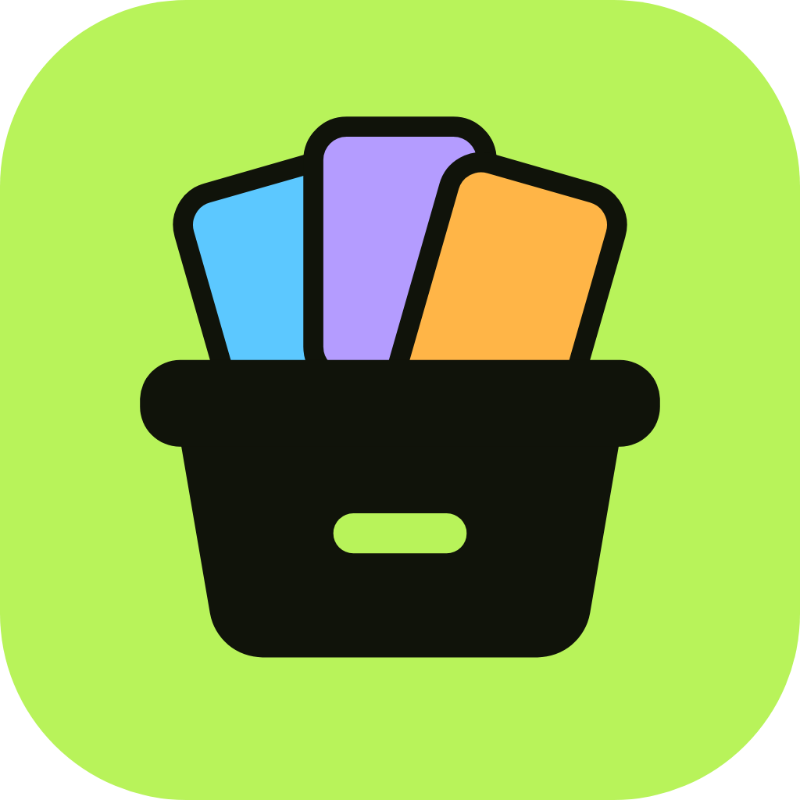
</p>

<h1 align="center">Englishbox</h1>

<p align="center">
  Offline angol jegyzetfüzet és szótanító app – magyar anyanyelvű tanulóknak.<br>
  Gyűjtsd össze a szavakat, kifejezéseket, nyelvtani szabályokat és mondatokat,<br>
  az app pedig a megfelelő időben ismétli őket veled.
</p>

<p align="center">
  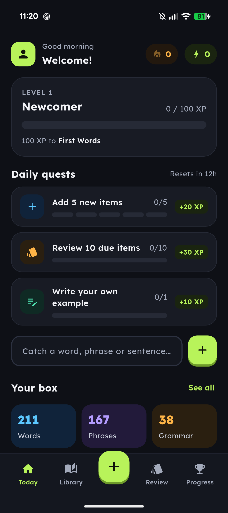
  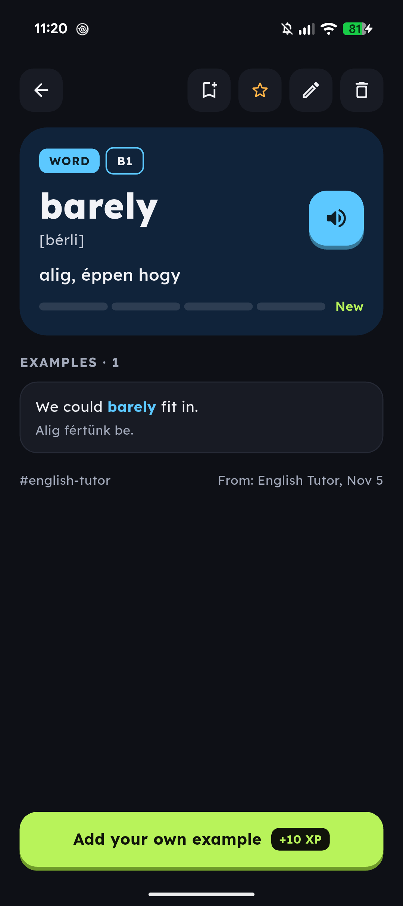
  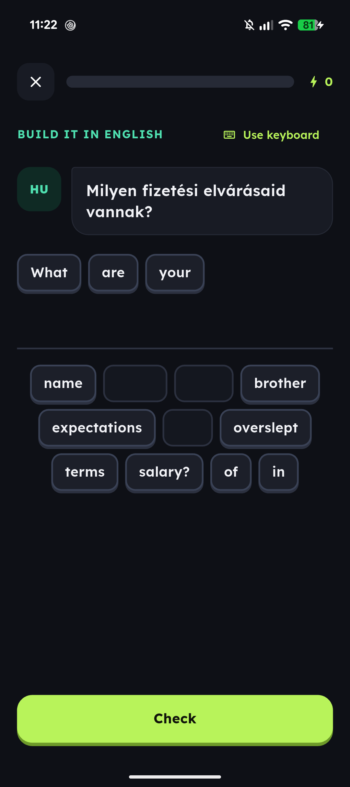
  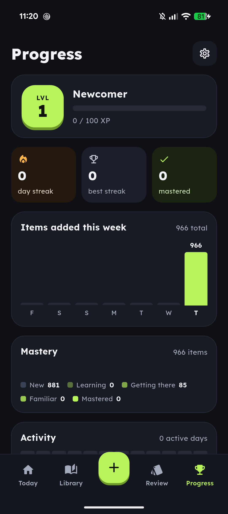
</p>

---

## Mit tud?

### 📥 Gyűjtés
- **Négy elemtípus:** szó, kifejezés (idióma, phrasal verb, kollokáció), nyelvtani szabály és mondat – mindegyiknek saját színe és űrlapja.
- **Szavaknál:** kiejtés (IPA) egy görgethető jelsorral, meghallgatás (szövegfelolvasó), szófaj, magyar jelentés.
- **Jegyzet** formázással: félkövér, dőlt, kiemelés, felsorolás.
- **Példamondatok** a kiemelt szóval – ezek külön mondatként is bekerülnek az ismétlésbe. A „From my box” gombbal meglévő mondatot is hozzá lehet kötni.
- **Nyelvtani szabályok** képlettel (pl. **If** + past simple + **would** + verb), magyarázattal, „magyar csapda” megjegyzéssel, helyes és hibás példákkal.
- **Hasonló szavak** összekötése (kölcsönösen), címkék, forrás, CEFR-szint (A1–C2).
- **Gyorsrögzítés** a Today képernyőről: beírod, és az app kitalálja, szó, kifejezés vagy mondat.

<p>
  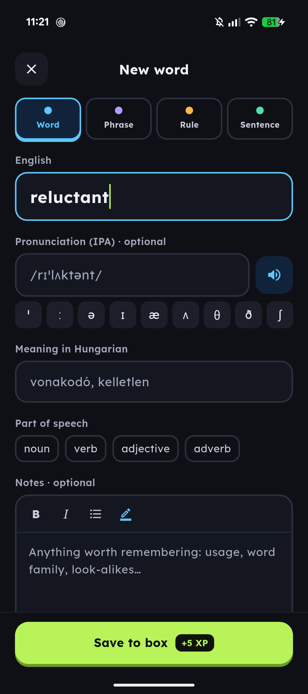
  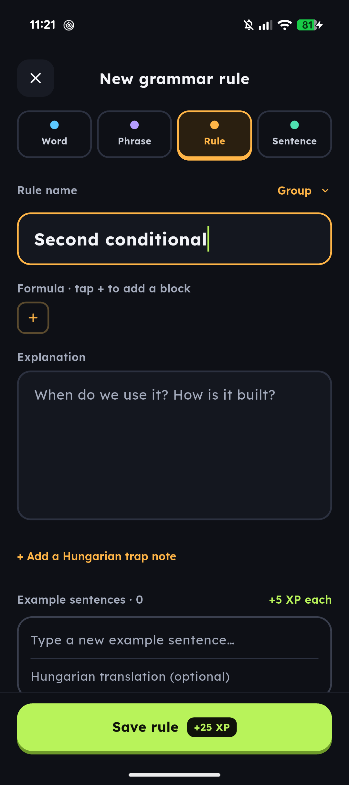
  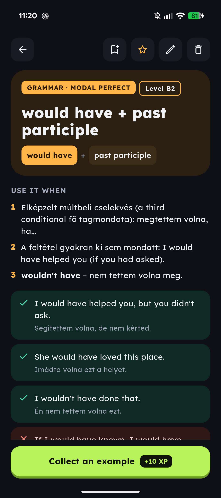
</p>

### 🔁 Ismétlés (spaced repetition)
Egyszerűsített **SM-2** ütemezés (mint az Ankiban): amit jól tudsz, egyre ritkábban jön elő, amit elfelejtesz, hamarabb.

- **Szókártyák** – angolról magyarra és fordítva, a hátoldalon példamondattal és fordítással.
- **Mondatépítés** szócsempékből (Duolingo-szerűen), vagy billentyűzettel.
- **Szabad fordítás** – az eltérő szavakat kiemelve veti össze a mentett fordítással.
- **Forgot / Hard / Knew it** értékelés; az elfelejtett kártya a kör végén még egyszer előjön.

<p>
  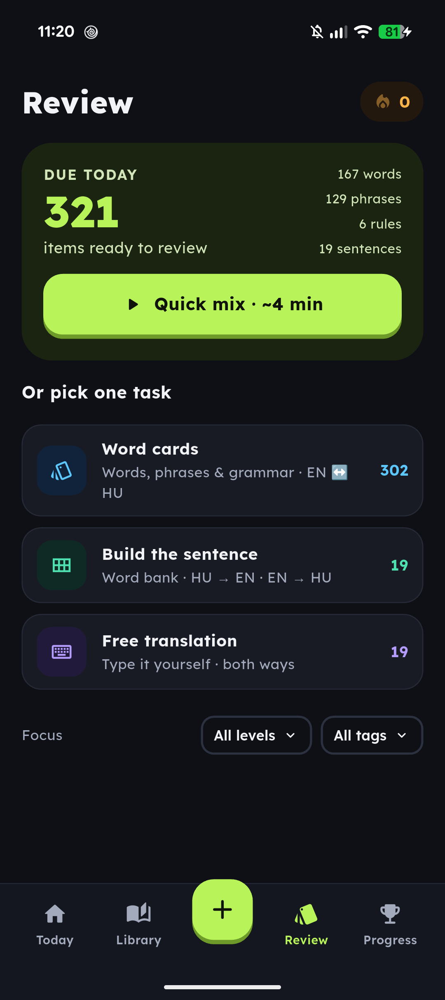
  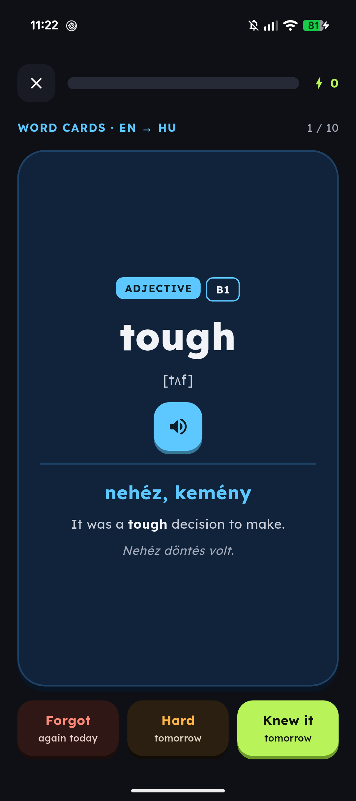
  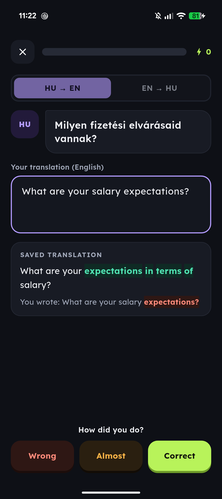
</p>

### 🏆 Motiváció
- **XP és szintek**, napi **streak** (opcionális „streak freeze”), **napi küldetések** felvehető XP-vel.
- **Progress:** heti diagram, tudásszintek eloszlása, 12 hetes aktivitási hőtérkép, 12 kitűző.
- **Játék mód kikapcsolható** – ilyenkor nincs XP, szint és küldetés, csak a tanulás.

### 📚 Rendszerezés
- **Library** kereséssel (ékezetfüggetlen, címkékben is) és szűrőkkel: típus, szint, címke, gyűjtemény, kedvencek.
- **Collections:** saját gyűjtemények ikonnal, színnel és „mastered” aránnyal; elemszám szintenként; címkék.

<p>
  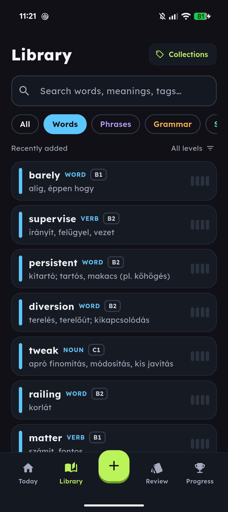
  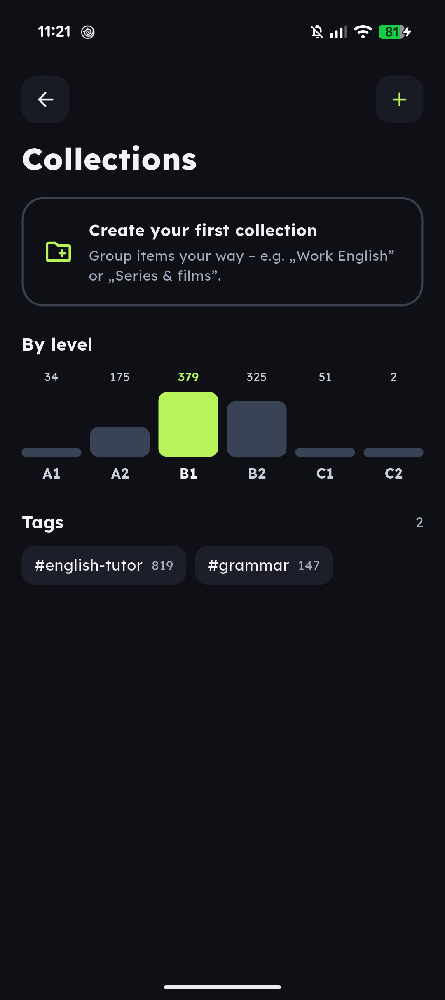
  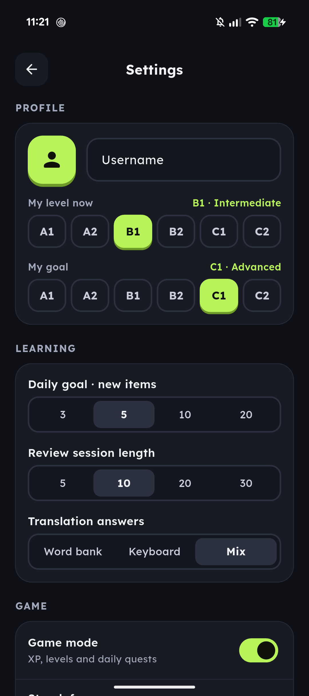
</p>

### ⚙️ Egyéb
- **Teljesen offline** – minden adat a telefonon, helyi SQLite adatbázisban.
- **Napi emlékeztető** értesítés (nem szól, ha aznap már gyakoroltál).
- **Mentés és visszatöltés** JSON fájlba (megosztható, pl. Drive-ra).
- Brit vagy amerikai kiejtés, állítható felolvasási sebesség.

---

## Technológia

| | |
|---|---|
| Keretrendszer | Flutter 3.47 · Dart 3.13 · csak Android |
| Állapotkezelés | [Riverpod 3](https://riverpod.dev) |
| Navigáció | [go_router](https://pub.dev/packages/go_router) (`StatefulShellRoute` az alsó sávhoz) |
| Adatbázis | [drift](https://drift.simonbinder.eu) (SQLite), élő lekérdezésekkel |
| Egyéb | flutter_tts, flutter_local_notifications, share_plus, file_picker |
| Betűtípus | Lexend |

### Mappaszerkezet

```
lib/
├── app/            téma, router, feliratok, formázás
├── data/           drift adatbázis, táblák, repositoryk, providerek, mentés
├── domain/         tiszta Dart logika: SRS, XP, szintek, streak, küldetések, kitűzők
├── services/       felolvasás, emlékeztetők
├── widgets/        közös UI elemek
└── features/       képernyők: today, add, library, item_detail, review,
                    progress, collections, settings
tool/
└── convert_english_tutor.dart   régi „English Tutor” export → Englishbox mentés
```

A képernyők csak a repositorykon keresztül érik el az adatbázist; az üzleti
logika (ütemezés, XP, streak) a `domain/` mappában van, Flutter nélkül.

---

## Futtatás

```
flutter pub get
dart run build_runner build
flutter run
```

A `build_runner` a drift által generált `db.g.dart`-ot készíti el – akkor kell
újra futtatni, ha a táblák (`lib/data/tables.dart`) változnak.

Release APK:

```
flutter build apk --release
```

Ellenőrzés:

```
flutter analyze
```

---

## Adatok importálása

A **Settings → Your data → Import backup** egy Englishbox mentésfájlt tölt be.
⚠️ Az import a **teljes dobozt lecseréli** (elemek, haladás, XP, beállítások).

---

## Képernyőképek frissítése

A képek a `docs/screenshots/` mappában vannak. Telefonról, USB-n csatlakoztatva:

```
adb exec-out screencap -p > docs\screenshots\today.png
```

| Fájl | Képernyő |
|---|---|
| `today.png` | Today |
| `word.png` | Egy szó részletei |
| `add_word.png` | Add → Word |
| `add_rule.png` | Add → Rule |
| `rule.png` | Egy nyelvtani szabály részletei |
| `review.png` | Review fül |
| `review_card.png` | Szókártya (felfordítva) |
| `review_build.png` | Mondatépítés |
| `review_translate.png` | Szabad fordítás, ellenőrzés után |
| `library.png` | Library |
| `collections.png` | Collections |
| `progress.png` | Progress |
| `settings.png` | Settings |
